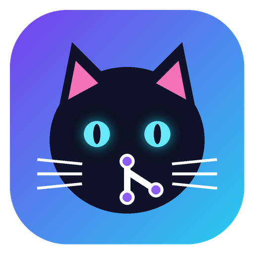

<p align="center"></p>

<h1 align="center">GitCat</h1>

<p align="center">A fast Git desktop client for Windows and macOS that works with GitHub, GitLab, Gitee, Gitea, Bitbucket, Azure DevOps and any other git host.</p>

<p align="center"><b>English</b> · <a href="README_zh.md">简体中文</a> · <a href="README_ja.md">日本語</a> · <a href="README_ko.md">한국어</a> · <a href="README_fr.md">Français</a> · <a href="README_es.md">Español</a> · <a href="README_pt.md">Português</a> · <a href="README_th.md">ไทย</a> · <a href="README_ms.md">Bahasa Melayu</a> · <a href="README_ru.md">Русский</a></p>

## Features

| Area | What you get |
| --- | --- |
| Changes | Staged / unstaged lists with filter, **hunk and line staging**, unified or **side-by-side** diff with word highlight, conflict resolution (ours / theirs / merge tool), amend, sign-off, commit & push |
| History | Lane graph with branch / tag badges and avatars, quick filter, deep search (message / author / code `-S` / path), compare commits, blame, file history, restore any file version |
| Files | Browse the project at the working tree or **any branch, tag or commit**, code viewer, content search (`git grep`), **compare any file version with any other** (or a file outside the repo) |
| Branches & tags | Checkout, create, rename, delete, upstream, merge (ff / no-ff / ff-only / squash), rebase, **interactive rebase**, cherry-pick, revert, reset, bisect, tags (annotated / lightweight, push / delete remote) |
| Release | **One-click release**: detects version files, bumps semver, updates `CHANGELOG.md`, commits, tags and pushes, then shows the CI run it triggered |
| Accounts | GitHub, GitLab, Gitee, Gitea / Forgejo, Bitbucket, Azure DevOps, any host. Sign in with a **token**, the **browser** (Git Credential Manager) or **SSH**; edit, verify, set default, sign out; bind an account to a repository |
| CI & releases | GitHub Actions, GitLab pipelines, Bitbucket Pipelines and Gitea Actions with job / step status; re-run, cancel, trigger; releases list; create pull / merge requests |
| Command Center | **80 git commands** as forms with live preview, docs link and safety prompts, plus a free-form git command line |
| More | Repository tabs, stashes, worktrees, submodules, reflog, clean, patches, archives, git console, command palette (`Ctrl+Shift+P`), insights, 4 themes, 10 languages, self-update |

## Accounts and credentials

GitCat uses git's own credential system, so it works with whatever you already use on the command line:

1. **Existing setup**: if `git push` already works in a terminal (Git Credential Manager, Keychain, SSH agent, `~/.ssh/config`), GitCat uses the same credentials without any configuration.
2. **Environment**: `GITHUB_TOKEN`, `GH_TOKEN`, `GITLAB_TOKEN`, `GITEE_TOKEN`, `GITEA_TOKEN`, `BITBUCKET_TOKEN`, `AZURE_DEVOPS_EXT_PAT`, and the `gh` / `glab` CLIs are detected and can be imported under **Accounts → Environment**.
3. **Accounts** (menu **Accounts**, `Ctrl+Alt+A`):
   - **Token**: paste a personal access token ("Create token" opens the right page on each provider), "Verify" fills in your name, e-mail and avatar.
   - **Browser**: signs in through Git Credential Manager's OAuth window (bundled with Git for Windows).
   - **SSH**: pick or generate an `ed25519` key, copy the public key, open the provider's SSH-key page, test the connection.
   - Tokens are stored in the system credential store via `git credential approve`. Storing them in GitCat's config file is possible but must be chosen explicitly.
4. **Several accounts on one host**: *Use for this repository* writes `user.name`, `user.email`, `core.sshCommand` (SSH) or the username into the HTTPS remote URL for that repository only.

Self-hosted GitLab / Gitea / GitHub Enterprise work by entering your host name when adding the account.

## Install

Download the zip for your platform from [Releases](https://github.com/liu294100/git-cat/releases):

| Platform | File |
| --- | --- |
| Windows 10/11 x64 | `GitCat-Windows-x64-onefile-v<version>.zip` |
| macOS Apple Silicon | `GitCat-macOS-arm64-onefile-v<version>.zip` |
| macOS Intel | `GitCat-macOS-x64-onefile-v<version>.zip` |

Git must be installed (Windows: [Git for Windows](https://git-scm.com/download/win); macOS: `xcode-select --install` or Homebrew). On macOS, right-click → Open on first launch because the app is not notarized.

Help → *Check for updates* downloads the new zip, verifies it against `SHA256SUMS`, replaces the program and restarts.

## Run from source

```bash
python -m pip install -r requirements.txt
python -m gitcat [path/to/repo]
```

Python 3.10+ is required.

## Build

| Platform | Command | Output |
| --- | --- | --- |
| Windows | `release.bat [version]` | `release/GitCat-Windows-x64-onefile-v<version>.zip` |
| macOS | `./release.sh [version]` | `release/GitCat-macOS-<arm64\|x64>-onefile-v<version>.zip` |

Both scripts create `.venv`, install `requirements-build.txt` and run PyInstaller with `GitCat.spec` (icon, Windows file version info, macOS bundle metadata).

## Publishing a release

1. Bump `__version__` in `gitcat/__init__.py` and add a `## vX.Y.Z` section to `CHANGELOG.md`.
2. Commit, then `git tag vX.Y.Z && git push origin vX.Y.Z`, or use GitCat's own 🚀 release wizard.
3. `.github/workflows/release.yml` checks the tag matches `__version__`, builds Windows x64, macOS arm64 and macOS x64, writes `SHA256SUMS` and publishes the GitHub Release with the CHANGELOG section as notes.

Running the workflow manually (`workflow_dispatch`) builds the packages as artifacts without publishing.

## Architecture

```
gitcat/
├── core/        git domain, no Qt: models, process runner, repo facade, diff/patch, graph layout,
│                hosting URL parsing, git credential wrapper
├── services/    use cases: snapshot loader, accounts, provider REST clients, command catalogue,
│                release, self-updater
├── common/      i18n, config, resources, OS integration, text helpers
├── ui/          PySide6: widgets, dialogs, pages, repo view + operation mixins, main window, theme
└── locales/     <lang>.json translations
```

Dependencies only point downwards (`ui → services → core`, everything may use `common`). All git work runs in a thread pool; a refresh runs its read-only git queries in parallel and is coalesced, history reloads only when HEAD or a ref changes, and `.git` is watched instead of polled.

## Development

```bash
python -m pyflakes gitcat           # lint
python scripts/check_locales.py     # every key present in all 10 languages
python scripts/generate_icons.py    # regenerate assets/ (needs Pillow)
```

Config file: `%APPDATA%\GitCat\config.json` (Windows), `~/Library/Application Support/GitCat/config.json` (macOS).

See [CHANGELOG.md](CHANGELOG.md) for the release history.
